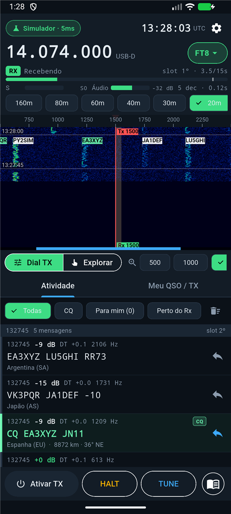
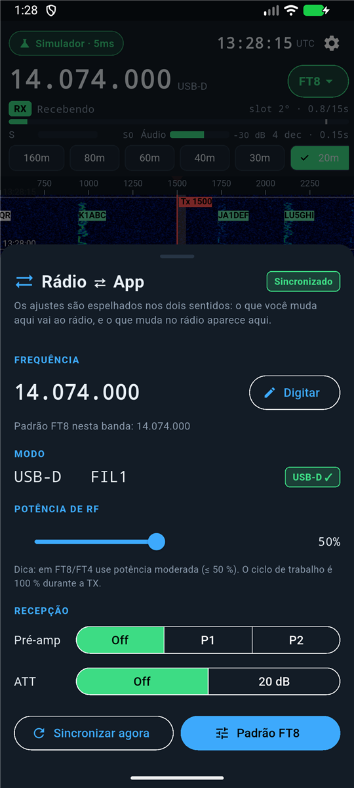
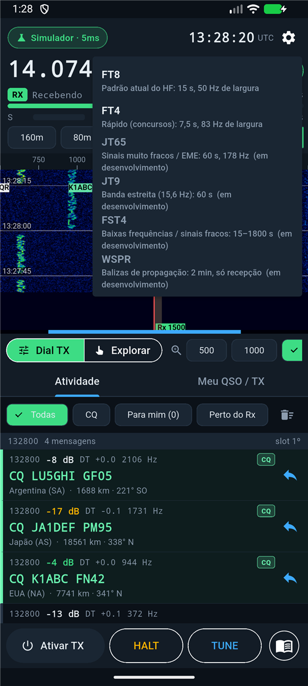

# JTMobile

**Operação de modos digitais de HF no Android, sem fio, com o Icom IC-705.**
FT8 e FT4 hoje; JT65, JT9 e outros na sequência. Interface pensada para o celular, com waterfall
explorável, informações claras da estação que está transmitindo e sincronização bidirecional com o rádio.

> Projeto de código aberto (GPL-3.0). Inspirado em JTDX e WSJT-X, mas é uma implementação nova.
> **Estado: alfa.** Decodificação, TX, QSO automático, logbook e o protocolo de rede do IC-705 estão
> implementados e testados em simulação e com um "rádio falso"; **a conexão com um IC-705 real ainda não foi
> validada em campo** (veja [Estado do projeto](#estado-do-projeto)).

---

<p align="center">
  
  
  
</p>
<p align="center"><sub>Capturas no emulador Android com o <b>simulador de rádio</b> (estações e sinais fictícios).</sub></p>

## Sumário

1. [Recursos](#recursos)
2. [Estado do projeto](#estado-do-projeto)
3. [Instalação do APK](#instalação-do-apk)
4. [Configurando o IC-705](#configurando-o-ic-705)
5. [Primeiros passos no app](#primeiros-passos-no-app)
6. [Como funciona (resumo)](#como-funciona-resumo)
7. [Estrutura do repositório](#estrutura-do-repositório)
8. [Desenvolvimento](#desenvolvimento)
9. [Roadmap](#roadmap)
10. [Documentação](#documentação)
11. [Contribuindo](#contribuindo)
12. [Licença e créditos](#licença-e-créditos)
13. [Aviso legal](#aviso-legal)

---

## Recursos

| Área | O que o app faz |
|---|---|
| **Conexão** | IC-705 via **Wi-Fi** com o mesmo protocolo de rede do app Icom **RS-MS1A** (UDP 50001/50002/50003: login, CI-V e áudio). Também há um **simulador** de rádio para testar sem hardware. |
| **Modos** | **FT8** e **FT4** (decodificação + transmissão). Arquitetura pronta para JT65, JT9, FST4 e WSPR (catálogo em `core/modes.dart`; veja [docs/MODOS.md](docs/MODOS.md)). |
| **Waterfall** | Zoom por pinça (300–3200 Hz) e atalhos de largura (500/1000/2000/3200 Hz); modo **Dial TX** (deslize o espectro sob a mira central para escolher a frequência de transmissão); modo **Explorar**; marcadores Rx/Tx com a largura real do sinal; etiquetas de indicativos sobre os sinais; linhas de slot com hora UTC. |
| **Indicadores** (estilo JTDX) | Frequência de dial, modo (USB-D), relógio UTC com compensação, barra do período (1º/2º), RX/TX com a mensagem em transmissão, S-meter / PO / SWR, nível de áudio (dBFS), nº de decodificações e tempo de decodificação, latência/perdas do enlace, DT mediano. |
| **Atividade da banda** | UTC, SNR, DT, frequência e mensagem; filtros (Todas / CQ / Para mim / Perto do Rx); etiquetas **CQ**, **PARA MIM**, **JÁ TRAB.**, **NOVO PAÍS**; país/continente, distância e azimute. Toque na linha = **ficha completa da estação**; ícone de resposta = inicia o QSO. |
| **QSO** | Mensagens Tx1–Tx6, auto-sequência, escolha do período de TX (1º/2º), manter frequência de TX, CQ personalizável, HALT e TUNE. |
| **Sincronização app ↔ rádio** | Frequência, modo/DATA/filtro, potência de RF, pré-amplificador e atenuador são **lidos do rádio** e **escritos pelo app**, nos dois sentidos, com proteção contra "eco" (veja [docs/SINCRONIZACAO.md](docs/SINCRONIZACAO.md)). Avisos quando o rádio está fora de USB-D ou da frequência padrão do modo. |
| **Áudio de baixa latência** | Decimação nativa 48→12 kHz, linha do tempo de áudio que absorve *jitter* e preenche perdas, e decodificação disparada pelo **áudio** (não pelo relógio de parede). Calibração do relógio pelo DT (veja [docs/AUDIO.md](docs/AUDIO.md)). |
| **Alertas e guia** | **Alerta visual + sonoro + vibração** quando você começa a transmitir, quando uma estação responde e quando o QSO termina (faixa colorida no topo, borda piscando, sons sintetizados). Um **guia na tela** diz o que está acontecendo e qual é o próximo passo, com botão de ação; tutorial "Seu primeiro QSO" (veja [docs/SIMULADOR.md](docs/SIMULADOR.md)). |
| **Simulador** | Estações fictícias que **respondem de verdade**: você responde a um CQ ou chama CQ e o QSO completo acontece (Tx1…73) sem rádio, com os mesmos alertas. |
| **Logbook** | Persistente em **ADIF** (`jtmobile_logbook.adi`), com busca, edição, exclusão, dupe-check e exportação **ADIF/CSV** (compartilhar). Campos de status para **LoTW / QRZ.com / eQSL / Club Log / HRDLog** já gravados (integração online: fase 2, veja [docs/LOGBOOK.md](docs/LOGBOOK.md)). |

## Estado do projeto

| Componente | Estado | Como foi verificado |
|---|---|---|
| Decodificação FT8/FT4 (ft8_lib) | ✅ funciona | Gravações de referência do WSJT-X no emulador Android: mesmas mensagens e frequências (±2 Hz) nos sinais mais fortes; 4–17 mensagens/slot em 20–90 ms |
| Sensibilidade vs JTDX | ⚠️ menor | ft8_lib é de passe único; JTDX/WSJT-X decodificam mais sinais fracos (multipasso, subtração, AP). Ver [Roadmap](#roadmap) |
| DT / SNR | ✅ DT calibrado, ⚠️ SNR aproximado | DT ±0,1 s do WSJT-X; SNR com erro típico de ±5 dB |
| TX FT8/FT4 + QSO automático | ✅ em simulação | Sequência completa contra estações simuladas |
| Protocolo de rede Icom (login, CI-V, áudio RX/TX) | ✅ contra "rádio falso" | `app/test/icom_link_test.dart` (segue o protocolo do kappanhang) |
| **IC-705 real** | ❌ **não testado** | Sem hardware na fase de desenvolvimento. Pode haver diferenças de firmware |
| Sincronização app↔rádio | ✅ lógica testada | `app/test/radio_sync_test.dart` + leitura CI-V no teste de protocolo |
| Logbook ADIF | ✅ | `app/test/logbook_test.dart` |
| JT65 / JT9 / FST4 / WSPR | ⏳ planejados | Catálogo e interface prontos; decodificadores a portar |
| Integração LoTW/QRZ/eQSL/Club Log | ⏳ fase 2 | Interface `LogbookService` definida |

Total: **54 testes automatizados** passando e `flutter analyze` sem avisos.

## Instalação do APK

### Opção A — pelo PowerShell (Windows) com depuração USB

1. No celular: *Configurações → Sobre o telefone →* toque 7× em **Número da versão**; depois *Opções do desenvolvedor →* ligue **Depuração USB**.
2. Conecte o cabo USB, aceite a permissão no celular e rode (ajuste o caminho do APK):

```powershell
& "$env:LOCALAPPDATA\Android\Sdk\platform-tools\adb.exe" install -r "C:\JTDX_Mobile\dist\JTMobile-arm64-v8a.apk"
```

Ou use o script do repositório, que localiza o `adb`, lista o aparelho e instala:

```powershell
powershell -ExecutionPolicy Bypass -File .\tools\install.ps1 -Apk "C:\JTDX_Mobile\dist\JTMobile-arm64-v8a.apk"
```

### Opção B — direto no celular
Copie o APK para o aparelho (cabo, Drive, Telegram…), abra-o e permita *"Instalar apps desconhecidos"* para o aplicativo que o abriu.

> Escolha o APK certo: **arm64-v8a** (celulares atuais), **armeabi-v7a** (32 bits antigos) ou **x86_64** (emulador).
> Os APKs não são versionados no Git; gere-os com `flutter build apk --release --split-per-abi` (veja [docs/DESENVOLVIMENTO.md](docs/DESENVOLVIMENTO.md)).

## Configurando o IC-705

O app usa o servidor de rede embutido no IC-705 (o mesmo que o RS-MS1A usa):

1. No rádio habilite o **Network control** (menu WLAN › Remote) e cadastre **Network User1** (usuário e senha).
2. Portas UDP padrão **50001 / 50002 / 50003**. Configure `DATA MOD = WLAN` para que o áudio de dados passe pela rede.
3. Conecte o celular ao **Wi-Fi do próprio rádio** (modo *Access Point*; IP típico `192.168.200.1`) **ou** coloque rádio e celular na mesma rede.
4. No app: **Configurações → Rádio → Icom IC-705 via Wi-Fi**, informe IP, usuário e senha e toque em **Vincular app ao Wi-Fi do rádio**
   (o Wi-Fi do rádio não tem internet e o Android tentaria usar o 4G/5G para os pacotes UDP).
5. **Feche o RS-MS1A e o JTDX no PC**: o rádio atende **um** cliente de rede por vez.

Dicas: ligue o **CI-V Transceive** no rádio para que mudanças de frequência/modo cheguem ao app instantaneamente (sem ele, em 1–4 s por polling).

> ⚠️ Os nomes exatos dos menus variam com a versão do firmware. Confirme no manual do IC-705.

## Primeiros passos no app

1. Informe **indicativo** e **grid** (primeira execução). O app inicia no **Simulador**; troque para o IC-705 em *Configurações*.
2. Toque na **frequência** (cabeçalho) para abrir o **painel do rádio**: veja/ajuste frequência, modo, potência, pré-amp e ATT.
3. Escolha **modo** (FT8/FT4) e **banda**: o app leva o rádio à frequência padrão e a **USB-D**.
4. Deslize a **waterfall** (modo *Dial TX*) até um trecho livre: a mira central é a sua frequência de transmissão. Pinça = zoom.
5. Toque em **↩ (responder)** numa chamada CQ (linha verde): o app **arma o TX** e conduz o QSO sozinho — ou use **Chamar CQ** no guia. Você é **avisado** (visual + som + vibração) ao transmitir, quando a estação responde e quando o QSO termina. **HALT** interrompe tudo na hora.
6. Ao concluir o QSO o app pede a confirmação do registro; o **Logbook** permite buscar, editar e exportar ADIF/CSV.

## Como funciona (resumo)

```
IC-705 ──Wi-Fi (UDP: controle 50001 · CI-V 50002 · áudio 50003)──▶ icom_link.dart
   ▲                                                                  │ áudio PCM 48 kHz
   │ PTT, frequência, modo, potência (CI-V)                           ▼
RadioSync ◀──── Engine ◀──── AudioTimeline → decimador → buffer do slot → ft8_lib (C, FFI) → decodes
                  │                                  └→ FFT → waterfall (UI)
                  ├── QsoManager (Tx1…Tx6, auto-sequência) ──▶ síntese GFSK ──▶ áudio de TX ──▶ rádio
                  └── QsoLog (ADIF)  ──(fase 2)──▶ LoTW · QRZ · eQSL · Club Log
```

Detalhes em [docs/ARQUITETURA.md](docs/ARQUITETURA.md).

## Estrutura do repositório

```
app/                      projeto Flutter (Android)
  lib/radio/              protocolo de rede Icom, CI-V, enlace abstrato (RadioLink)
  lib/engine/             motor (slots, áudio, waterfall, TX, QSO), RadioSync, AudioTimeline, simulador
  lib/core/               FFI do codec, modos/bandas, mensagens FT8, DXCC, geodésia, configurações
  lib/logbook/            ADIF, registro de QSO, logbook persistente, interface de integrações
  lib/ui/                 telas: cabeçalho, waterfall, atividade, QSO, rádio, log, configurações
  android/.../cpp/        ponte C (ftx_bridge.c) + ft8_lib (MIT) via CMake/NDK
  test/                   testes unitários e de protocolo
docs/                     documentação técnica (arquitetura, protocolo, áudio, modos, logbook, dev)
tools/                    scripts (instalação do APK)
```

## Desenvolvimento

```powershell
cd app
flutter pub get
flutter analyze
flutter test
flutter build apk --release --split-per-abi   # APKs em app/build/app/outputs/flutter-apk/
```

Pré-requisitos, solução de problemas no Windows (`Unable to establish loopback connection`), uso do emulador e da
ferramenta de depuração de WAVs: [docs/DESENVOLVIMENTO.md](docs/DESENVOLVIMENTO.md).

## Roadmap

Resumo (completo em [docs/ROADMAP.md](docs/ROADMAP.md)):

1. **Validar com o IC-705 real** (login, áudio, PTT, atraso de TX) — *prioridade máxima*.
2. Decodificador de maior sensibilidade (multipasso/subtração/AP; port do decodificador do JTDX).
3. **JT65** e **JT9** (decodificação e TX), depois FST4 e WSPR.
4. Integração de logbooks online: **QRZ.com**, **LoTW** (via TQSL), **eQSL**, **Club Log**.
5. Serviço em primeiro plano (operar com a tela apagada), NTP/GPS, PSK Reporter, cty.dat completo.

## Documentação

| Documento | Conteúdo |
|---|---|
| [docs/ARQUITETURA.md](docs/ARQUITETURA.md) | Camadas, módulos, fluxo de dados, decisões de projeto |
| [docs/PROTOCOLO_ICOM.md](docs/PROTOCOLO_ICOM.md) | Protocolo UDP de rede da Icom e CI-V, formato dos pacotes |
| [docs/SINCRONIZACAO.md](docs/SINCRONIZACAO.md) | Sincronização app ↔ rádio (regras, janela de guarda, parâmetros) |
| [docs/SIMULADOR.md](docs/SIMULADOR.md) | Como fazer um QSO completo no simulador, alertas, guia na tela |
| [docs/AUDIO.md](docs/AUDIO.md) | Caminho de áudio, latência, `AudioTimeline`, TX, calibração por DT |
| [docs/MODOS.md](docs/MODOS.md) | Modos digitais e **como adicionar um novo modo** |
| [docs/LOGBOOK.md](docs/LOGBOOK.md) | Logbook, ADIF e plano de integração com LoTW/QRZ/eQSL/Club Log |
| [docs/DESENVOLVIMENTO.md](docs/DESENVOLVIMENTO.md) | Ambiente, build, testes, emulador, depuração |
| [docs/ROADMAP.md](docs/ROADMAP.md) | Pendências e próximos passos priorizados |
| [docs/ESTUDO_VIABILIDADE.md](docs/ESTUDO_VIABILIDADE.md) | Estudo inicial (JTDX, IC-705, modos, Android) |
| [AGENTS.md](AGENTS.md) | Guia para **assistentes de IA** trabalharem no projeto |
| [CONTRIBUTING.md](CONTRIBUTING.md) | Como contribuir |
| [THIRD_PARTY_NOTICES.md](THIRD_PARTY_NOTICES.md) | Licenças de terceiros |

## Contribuindo

Veja [CONTRIBUTING.md](CONTRIBUTING.md). Em resumo: abra uma *issue* descrevendo o problema/ideia, rode `flutter analyze` e
`flutter test` antes do *pull request*, comente o código em português (o padrão do projeto) e atualize a documentação afetada.

## Licença e créditos

**GNU GPL v3** (veja [LICENSE](LICENSE)). Escolhida para manter o projeto aberto e permitir, no futuro, incorporar código do
JTDX/WSJT-X (também GPL).

Componentes de terceiros (detalhes em [THIRD_PARTY_NOTICES.md](THIRD_PARTY_NOTICES.md)):
* **ft8_lib** — Karlis Goba (MIT): codificação/decodificação FT8/FT4.
* **kappanhang** — HA2NON / ES1AKOS (MIT): referência do protocolo de rede Icom.
* Protocolos **FT8/FT4/JT65/JT9** — Joe Taylor (K1JT), Steve Franke (K9AN), Bill Somerville (G4WJS) e colaboradores (WSJT-X).
* **JTDX** — Igor Chernikov (UA3DJY), Arvo Järve (ES1JA) e colaboradores: inspiração de interface e funções.

## Aviso legal

Transmitir exige **licença de radioamador** e respeito aos limites de potência, bandas e modos do seu país. O software é
fornecido **sem garantia**; use-o com carga fictícia/antena adequada e verifique potência e ROE antes de operar.
Este projeto não é afiliado à Icom, ao JTDX nem ao WSJT-X.
